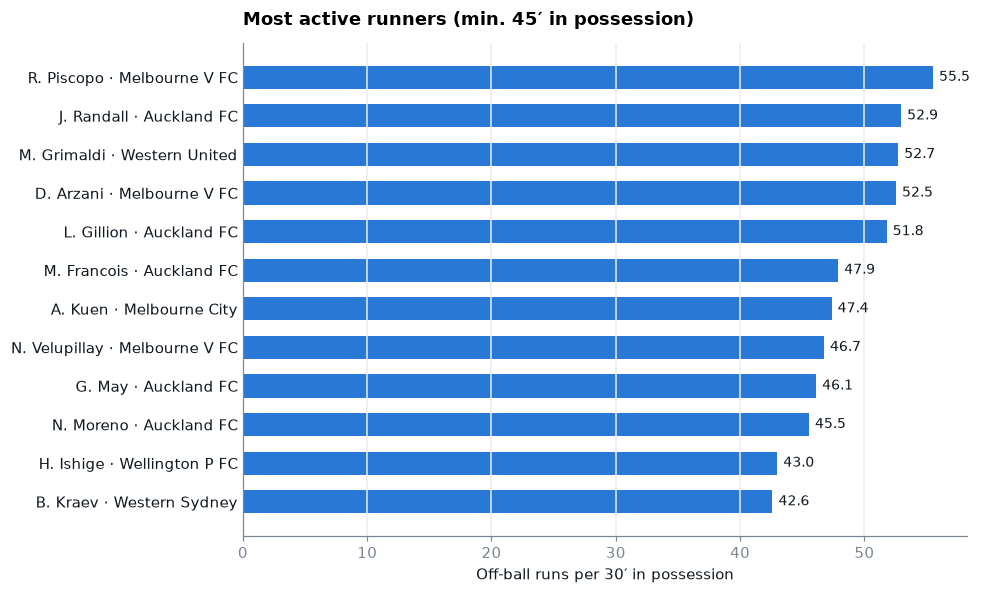

# football-dbt-duckdb

A use case for open-source analytics tools: **dbt + DuckDB on SkillCorner's open football data.** A complete local pipeline that ingests the data, builds staging, intermediate and mart models, runs tests and generates docs, with no cloud, credentials or cost.

You can use it in two ways:

- **Learn analytics engineering.** A complete, working pipeline on real
  football data (ingestion, layered dbt models, tests, docs and lineage) that
  you can read, run and extend.
- **Test dbt models locally.** Develop and test models against a single DuckDB
  file, then point `profiles.yml` at your warehouse when they're ready.

---

## Quickstart

You need Python 3.10+ and [uv](https://docs.astral.sh/uv/). The `duckdb` CLI
(1.1 or newer) is optional, for querying outside dbt.

```bash
make setup     # create a virtualenv and install dbt-duckdb
make ingest    # download the open data into data/raw/  (~90 MB)
make build     # run every model and test               (~2 s)
```

That's it. You now have a database at `data/db/football.duckdb`. Try the
example queries:

```bash
duckdb data/db/football.duckdb < examples.sql
```

Or look at the lineage graph:

```bash
make docs
```

<details>
<summary>All make targets</summary>

```bash
make setup     # virtualenv + dbt-duckdb
make ingest    # download the SkillCorner data into data/raw/skillcorner/
make build     # run all models and tests
make update    # ingest + build: pick up new matches and rebuild
make test      # tests only
make docs      # dbt docs + lineage graph
make query     # DuckDB shell on the database
make notebook  # example notebook with a ready-made chart
make clean     # drop the database; raw files are kept
```

</details>

### Explore in a notebook

```bash
make notebook
```

[`notebooks/explore.ipynb`](notebooks/explore.ipynb) opens the database read-only, loads
the marts into pandas and draws a ready-made chart of the most active off-ball runners.
The first run installs Jupyter, pandas and matplotlib into the same virtualenv. Close the
notebook (or run its last cell) before the next `make build`, because DuckDB allows only one
writer.



### Working with Claude Code

The repo ships a project skill in
[`.claude/skills/football-dbt-duckdb/`](.claude/skills/football-dbt-duckdb/SKILL.md). When
you open the project in [Claude Code](https://claude.com/claude-code), it tells Claude how
to run the pipeline, which modelling rules to keep, the known gotchas and the chart
conventions, so you can ask things like "add a model for player possessions" or
"chart pressing intensity by team".

---

## The stack

| Tool | What it does here |
|---|---|
| [dbt](https://www.getdbt.com/) | Turns SQL files into a tested, documented pipeline with lineage |
| [DuckDB](https://duckdb.org/) | The database: a single file on disk, no server |
| [dbt-duckdb](https://github.com/duckdb/dbt-duckdb) | The adapter; it also reads CSV and JSON straight off disk, so there's no load step |
| [uv](https://docs.astral.sh/uv/) | Sets up the Python environment |
| [SkillCorner open data](https://github.com/SkillCorner/opendata) | Twenty 2024/25 A-League matches, MIT licensed |

---

## How it works

Data moves through four stages, and each one has a single job:

`data/raw/` → **staging** → **intermediate** → **marts**

The layers follow dbt's [best-practice project structure](https://docs.getdbt.com/best-practices/how-we-structure/1-guide-overview).
If you think in bronze / silver / gold, the idea is the same; only the names
differ:

| Stage | Medallion idea | Its job | Models |
|---|---|---|---|
| `data/raw/<provider>/` | bronze | The provider's files, byte for byte | `matches.json`<br>`{id}_match.json`<br>`{id}_dynamic_events.csv` |
| **staging** | bronze | One model per raw file type: renamed, typed, flattened, plus which file each row came from. No joins, no filters | `stg_skillcorner__matches`<br>`stg_skillcorner__match_players`<br>`stg_skillcorner__dynamic_events` |
| **intermediate** | silver | Clean tables at the grain you want to work with: one per event type, keyed, joined to names | `int_skillcorner__player_matches`<br>`int_skillcorner__off_ball_runs`<br>`int_skillcorner__passing_options`<br>`int_skillcorner__on_ball_engagements` |
| **marts** | gold | Answers to questions, per match and per season | `player_match_metrics`<br>`team_match_summary`<br>`team_season_summary` |

Model names follow the dbt convention: `stg_<provider>__<entity>` and
`int_<provider>__<entity>` (two underscores between provider and entity), and
marts are named for what they answer, with no prefix. Each layer is its own
schema in DuckDB: `main_staging`, `main_intermediate`, `main_marts`.

### 1. Ingestion: download the files

There is one script per provider in [`ingestion/`](ingestion/).
[`ingestion/skillcorner.py`](ingestion/skillcorner.py) downloads the files into
`data/raw/skillcorner/` and does nothing else: no parsing, no cleaning. That's
dbt's job.

It's safe to re-run. The match index (`matches.json`) is always re-fetched,
because that's how a newly published match gets discovered. Per-match files are
only downloaded if they're missing, so an update costs one small request plus
the new matches:

```
Match index (always refreshed)
  20 matches in the index
  19 already landed
  1 to download: [2017461]

Match 2017461
  landed   0.03 MB  2017461_match.json
  landed   3.96 MB  2017461_dynamic_events.csv
```

Files already on disk are never checked again. SkillCorner sometimes republishes
matches it has already released (in September 2026 it moved them to Dynamic
Events v3), and a plain `make update` won't pick those changes up. If your
numbers don't match a fresh clone, re-download everything:

```bash
.venv/bin/python ingestion/skillcorner.py --force && make build
```

### 2. Staging: the files, made queryable

Staging reads the raw files directly. dbt-duckdb lets a source point at a file
glob, so there's no separate loader:

```yaml
- name: dynamic_events
  meta:
    external_location: "read_csv('../data/raw/skillcorner/dynamic_events/*.csv',
                                 union_by_name=true, sample_size=-1, filename=true)"
```

A staging model has one source and no business logic. It flattens nested JSON,
renames to snake_case, casts, and adds `_source_file` and `_loaded_at`. If a
number downstream ever looks wrong, staging is what you compare with the
original file.

### 3. Intermediate: clean tables at a useful grain

The raw events file stacks four event types in one wide table. Each
intermediate model takes one event type, keeps the ~20 columns that matter for
it (out of 322), casts them, and gives booleans names that read as questions:
`dangerous` becomes `is_dangerous`, `break_defensive_line` becomes
`breaks_defensive_line`. Every table gets a proper key, such as `run_id` or
`engagement_id`. Joins start here too: `int_skillcorner__player_matches` adds
team names and drops players who never came on.

### 4. Marts: answer a question

Marts are aggregated, normalised and named for what they answer. Rates are
always shown next to their counts, so you can see the sample behind every
number.

### Picking up new data

`make update` runs ingestion and then rebuilds. Ingestion is incremental, but
the dbt build is a full rebuild on purpose: the whole database rebuilds in
about 2 seconds, so incremental models would add complexity for no gain.
They become worth it when a full rebuild no longer fits in the time you have.

---

## The data

[SkillCorner open data](https://github.com/SkillCorner/opendata): twenty 2024/25
Australian A-League matches, MIT licensed. The project uses two of the
published file types:

| File | Contents |
|---|---|
| `{id}_match.json` | Lineups, minutes played (total / in possession / out of possession), pitch dimensions |
| `{id}_dynamic_events.csv` | 322 columns, four event types stacked in one table |

Dynamic Events are derived from tracking data rather than from ball actions,
so they describe off-ball behaviour that ordinary event feeds don't record:

| `event_type` | What it is | Rows |
|---|---|---|
| `off_ball_run` | A run at 15+ km/h while a team-mate has the ball, ending as a passing option | 9,898 |
| `passing_option` | A moment when a player is rated as an available target | 48,308 |
| `on_ball_engagement` | A defender pressing or containing the player on the ball | 17,445 |
| `player_possession` | A player in control of the ball | 18,710 |

Column definitions come from *Dynamic Events CSV Specifications* (2025-02-16). Counts are for the
current release (Dynamic Events v3).

Things to keep in mind:

- Twenty matches means each team appears one to seven times, so season-level
  numbers are illustrations, not analysis.
- The `*_tracking_extrapolated.jsonl` files in the SkillCorner repo are git-LFS
  pointers: a plain download gives you a 133-byte stub. This project doesn't
  use them.
- The four event types share one wide table, so most columns are empty for any
  given row.

---

## Try it yourself

- **Add a source.** [docs/add-a-source.md](docs/add-a-source.md) walks you
  through adding SkillCorner's Phases of Play file, from download to a mart,
  in about 30 minutes.
- **Model possessions.** `player_possession` events are already in staging but
  have no intermediate model yet. Build `int_skillcorner__player_possessions`
  with `xshot`, `xloss` and `end_type`.
- **Add a dashboard.** [Evidence](https://evidence.dev) can read the DuckDB file
  directly.
- **Schedule it.** Run `make update` under Dagster or Prefect.

---

## Testing locally, then moving to a warehouse

`profiles.yml` is the only file tied to DuckDB. The models use standard SQL
plus a few DuckDB features (`count(*) filter (...)`, `unnest` and struct
access). To move to Postgres, Redshift or another warehouse, you change the
profile and rewrite the JSON handling in staging; intermediate and marts work
as they are.

That makes this a handy place to develop and test dbt models before running
them against a warehouse.

### Tests

`make build` runs 64 tests, using dbt's built-in generic
tests only, so there are no packages to install:

| Test | Applied to |
|---|---|
| `unique`, `not_null` | Every key in every layer |
| `relationships` | `match_id` on each event table → `stg_skillcorner__matches` |
| `accepted_values` | `run_type` (10 values), `engagement_type` (5), `position_group` (6) |
| Singular tests | SQL assertions in [`transform/tests/`](transform/tests/) |

The `accepted_values` tests are there on purpose: if the provider adds a new
run type, the build fails, instead of a mart number quietly changing.

A row-count check catches what column tests can't. Query 6 in `examples.sql`
compares staging with intermediate, and the counts should match exactly:

| `event_type` | staging | intermediate |
|---|---|---|
| `off_ball_run` | 9,898 | 9,898 |
| `on_ball_engagement` | 17,445 | 17,445 |
| `passing_option` | 48,308 | 48,308 |

---

## Design notes

Why the models are built the way they are. If you add models, these are worth
following too.

### The real key is `(match_id, event_id)`

`event_id` restarts every match: 94,361 rows carry only 5,831 distinct
values. Intermediate builds the pair into a single key, and
[`assert_dynamic_event_grain_is_match_plus_event.sql`](transform/tests/assert_dynamic_event_grain_is_match_plus_event.sql)
checks it, so a data drop that breaks the assumption fails the build instead of
duplicating rows in every join downstream.

### Per 30 minutes of possession, not per 90

Each player has three clocks per match:

| Column | Meaning |
|---|---|
| `minutes_played` | Time on the pitch |
| `minutes_tip` | Time on the pitch with their team in possession |
| `minutes_otip` | Time on the pitch with the opponent in possession |

[`macros/per_30.sql`](transform/macros/per_30.sql) normalises attacking
metrics (runs, passing options) per 30 minutes in possession, and defensive
metrics (engagements) per 30 minutes out of possession. Using minutes played
for defensive numbers would favour players in teams that spend a lot of time
without the ball. Rate columns carry their denominator in the name:
`..._per_30_tip`, `..._per_30_otip`.

### Season rates come from summed counts

Season models add up counts and minutes, then compute the rate. They don't
average per-match rates, because that would weigh a 15-minute cameo the same
as a full match. `matches_in_sample` is kept as a column so you can always see
how much data sits behind a row.

### Same input, same output

Rebuilding on unchanged data must give identical results. When an aggregate
picks one value out of many rows, it uses an explicit rule (`max(...)` or an
ordered `row_number()`), never `any_value(...)`, which can return a different
row on each run.

### Everything is a table

dbt's guide suggests views for staging. Here every layer is a table: a view
over `read_csv('../data/raw/...')` keeps a path relative to `transform/`, so it
breaks as soon as the database is opened from anywhere else, such as the
notebook or `make query`. With a two-second build, tables cost nothing.

### One approximation

`team_match_summary` uses the squad's `max(minutes_tip)` and
`max(minutes_otip)` as the team's possession clock, assuming someone played the
whole match. This is noted in the model.

---

## Models

| Layer | Model | One row per |
|---|---|---|
| staging | `stg_skillcorner__matches` | match |
| staging | `stg_skillcorner__match_players` | match × player (incl. unused subs) |
| staging | `stg_skillcorner__dynamic_events` | match × event |
| intermediate | `int_skillcorner__player_matches` | match × player who played |
| intermediate | `int_skillcorner__off_ball_runs` | run |
| intermediate | `int_skillcorner__passing_options` | passing option |
| intermediate | `int_skillcorner__on_ball_engagements` | engagement |
| marts | `player_match_metrics` | match × player |
| marts | `team_match_summary` | match × team |
| marts | `team_season_summary` | team, across its matches in the sample |

## Layout

```
ingestion/
  skillcorner.py                    download SkillCorner files (one script per provider)
transform/
  dbt_project.yml, profiles.yml     dbt config (DuckDB, local file)
  macros/per_30.sql                 normalisation rule
  models/
    staging/<provider>/             stg_<provider>__<entity>, sources
    intermediate/<provider>/        int_<provider>__<entity>
    marts/<provider>/               named for what they answer
  tests/                            singular tests
docs/add-a-source.md                tutorial: add a new file type
docs/img/                           chart images used in this README
notebooks/explore.ipynb             marts in pandas + an example chart
.claude/skills/                     project skill for Claude Code
examples.sql                        example queries
data/raw/<provider>/                downloaded files (gitignored)
data/db/football.duckdb             the DuckDB database (gitignored)
```

## Attribution

Data © SkillCorner, MIT licensed; see [NOTICE.md](NOTICE.md). This project is
independent of, and not endorsed by, SkillCorner.
